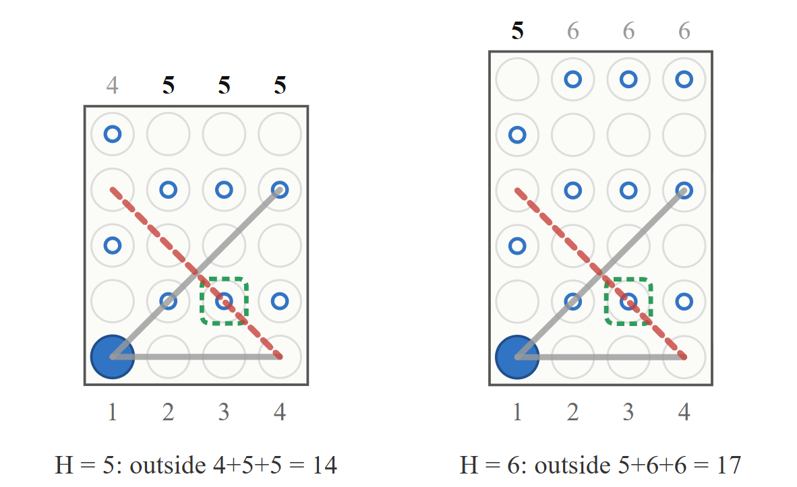
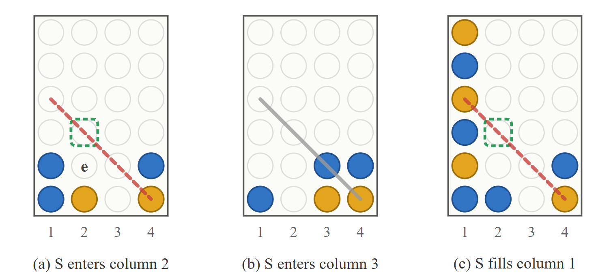
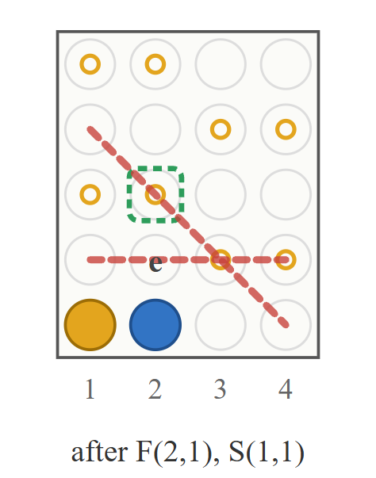
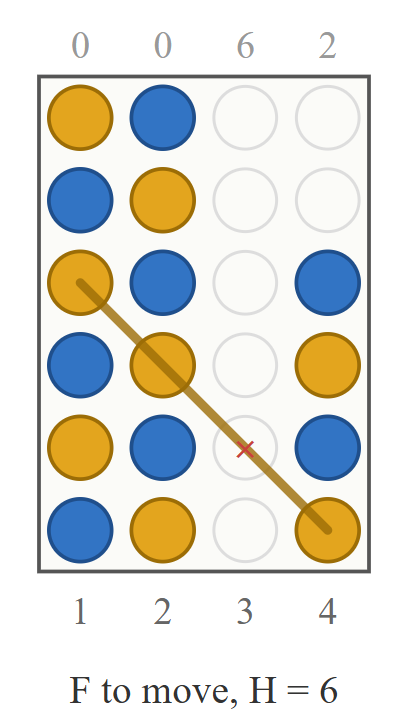

# Draw Strategies for Gravity Connect Four on One to Four Columns

## Covering, at most one exception, and Lean verification

GPT

25 November 2026

**Abstract** We give explicit non-losing strategies for both players in gravity Connect Four on boards one to four columns wide, at every finite height and on a board with no ceiling. The value of the game on all these boards is therefore a draw. Each player covers whenever possible, with at most one exception. To cover is to answer in the opponent's column. To switch actively is to answer elsewhere while that column is still playable. A forced change after a column fills counts only toward the total. For four columns we determine exactly how many active switches a non-losing strategy needs in the worst case. The first player needs one at even heights *H* ≥ 4 and none otherwise. The second player needs one at every height *H* ≥ 2 and none at *H* ≤ 1. The upper bounds rest on three facts. Support descent leaves only the bottom lines and a few exceptional lines to watch. Covering hands the defender every cell at even distance above a column top; we call these cells protected. The parity of the remaining capacity decides whether the defender can stay out of the column holding the protected cell it relies on. Explicit counter-strategies give the matching lower bounds. Lean 4 verifies the draw and exact active budgets throughout this range, and total-switch bounds of four and two for the first and second player on finite four-column boards.

**Keywords:** gravity Connect Four; non-losing strategy; covering; parity; Lean 4; formal verification.

## 1 Introduction

### 1.1 Results

The board has 1 ≤ *w* ≤ 4 columns and height *H*; the first player F and the second player S drop stones in turn, and the first four in a row wins. To *cover* is to reply in the column the opponent has just played. A reply in another column is *passive* if the opponent has just filled its column and *active* otherwise. The first player's opening move is not a reply and costs nothing.

**Theorem 1 (covering strategies).** For w ≤ 4 and every finite H ≥ 0, each player has a fixed non-losing strategy that covers whenever covering is legal, with at most one exception, which is an active switch. The same holds for a board with no ceiling.

**Theorem 2 (exact active budgets on four columns).** The least worst-case number of active switches of a non-losing strategy is:

| Height       | First player | Second player |
|--------------|--------------|---------------|
| *H* = 0, 1   | 0            | 0             |
| *H* = 2, 3   | 0            | 1             |
| odd *H* ≥ 5  | 0            | 1             |
| even *H* ≥ 4 | 1            | 1             |
| no ceiling   | 0            | 1             |

At widths at most three both budgets are zero, at every finite height and with no ceiling.

**Theorem 3 (total switches).** The finite four-column strategies constructed below use at most four switches in total; those of the second player use at most two. These are upper bounds for our constructions, not optimal totals.

### 1.2 The idea

If the defender always covers, every opponent stone outside the bottom row rests on a defender stone, except where the defender failed to cover. A first opponent four supported in this way is impossible, because the defender's four one row lower would have come first. So only a handful of lines can ever hurt the defender: the three lines that touch the bottom row, and the lines through the few cells where the opponent's stone stands on its own colour. Covering also decides the future of every column. If the opponent enters a column and the defender immediately covers, the defender receives the 2nd, 4th, 6th, ... cell above the current top. It is enough to give each dangerous line one cell of this kind and to keep it.

Two things can spoil the plan. The *bottom row* comes first. The first player's opening already blocks it. The second player has no stone there yet, and if it only covers, the first player completes the bottom row in four moves. This is why the second player must switch once. The *ceiling* comes second. When the opponent fills a column, the defender has to play elsewhere, and the column it enters shifts its protected cells by one row. Whether the defender can choose where such forced moves go is a matter of parity: an opponent can fill a column only if an odd number of its cells remain. For the first player at odd height, the three columns outside the one it relies on hold an even number of cells, so it is never forced into that column and needs no active switch. At even heights of at least four the outside count is odd, and the lower bound in Section 7 shows that one active switch is necessary.

### 1.3 Relation to earlier work

Allis gave a non-losing strategy for the second player on boards with at most six columns and a positive even number of rows \[1, §2.2\]; he calls the first player White and the second Black. We use F and S for the two roles. We prove the four-column instance directly, with its switch count. Claimeven and the even-capacity rules of \[1, §§6.1, 7.1\] are related background. Yamaguchi et al. studied infinite boards under several placement rules \[2\]; we make no priority claim for boards without a ceiling and include a short self-contained proof for our model (a floor, no ceiling, at most four columns). Tromp's computer search reports width-four boards of heights 4 to 11 as draws \[3\]. This paper replaces the version of 13 September 2026 \[5\], whose proof of the finite-height draws relied in part on finite certificates. The new proof is uniform in the height and uses no large enumerated strategy certificates. It also adds the exact active budgets and their lower bounds. A uniform response algorithm and its compressed execution are treated in the companion paper \[6\].

Sections 2 and 3 fix the rules and prove five lemmas. Sections 4 and 5 construct the strategies for the first and the second player, Section 6 treats boards without a ceiling, Section 7 proves the lower bounds, Section 8 assembles the theorems, and Section 9 describes the formal and computational checks.

## 2 Rules and the cost of a strategy

Columns are numbered 1 to *w* from the left and rows 1 to *H* from the floor; (*c*, *r*) is the cell in column *c*, row *r*. A move puts a stone in the lowest empty cell of a column that is not full. Four stones of one player in a horizontal, vertical or diagonal line win; play stops at the first such four, and a full board without one is a draw. With no ceiling there is a floor but no top row; a play that never produces a four is a draw. Column contents are written bottom to top, for example \[FS, ∅, ∅, F\]. In the lemmas, P is the defending player and Q its opponent, whichever moves first. Three lines recur:

*R*~0~ = (1,1)(2,2)(3,3)(4,4),    *D* = (1,4)(2,3)(3,2)(4,1),    *U*~1~ = (1,3)(2,4)(3,5)(4,6).

A strategy chooses a legal move at every history consistent with it; where the construction allows several moves we take the leftmost. We count the switches of one player only. The *active budget* of a non-losing strategy is the largest number of active switches it makes against any opponent play; Theorem 2 minimises this over all non-losing strategies, including ones that depend on the whole history. A reply that itself wins is counted by the same rule.

## 3 Five lemmas

### 3.1 Support descent and the lines to watch

**Lemma 1 (support descent).** Let a non-vertical line avoid the bottom row and carry four Q stones, each with a P stone directly below it. Then these four Q stones are not Q's first four.

**Proof.** The four supporting P stones lie on the line one row lower. By gravity each of them was placed before the Q stone on top of it, so P completed that lower four before Q's last stone. □

At a position with Q to move, the *exception set* *E* consists of every Q stone above row 1 that stands on a Q stone, together with the next empty cell of every column that is not full and has a Q stone on top. The second kind records an exception that may appear on the next visit to the column. The *watched lines* are the non-vertical lines that meet the bottom row or *E*; a watched line is *open* if it contains no P stone. By Lemma 1, a first Q four on a non-vertical line must use an open watched line, as long as no new exception appears.

**Lemma 2 (permanent defence).** At a position with Q to move, suppose that the run of Q stones at the top of each column that is not full has length at most two, and that no watched line is open. Then P does not lose if it covers whenever possible and plays in any legal column after Q fills a column.

**Proof.** A cover puts P on top of Q's stone, and a move after a fill puts P on some top; neither creates a new exception, and every potential exception that becomes actual was already in *E*. A Q run at the top of a column grows by one and is then capped, so no vertical four appears. Watched lines keep their P stones, and every other non-vertical line is excluded by Lemma 1. The argument applies to each Q move before P replies; a cover is legal unless Q filled the column, and then another legal move exists unless the board is full. □

If the same top-run and blocking conditions hold at a live position with P to move, any legal P stone keeps them, so P may play anywhere and then apply Lemma 2.

### 3.2 Protected cells

**Lemma 3 (protected cells).** Suppose column j has height h at a Q turn. Whenever Q plays there and a cover is legal, P must cover. P otherwise stays out of column j. Every in-board cell (j, h + 2k), k ≥ 1, then remains empty or belongs to P.

**Proof.** While the column remains open, each visit by Q is paired with a cover by P. In each pair Q occupies the odd offset and P the following even offset. If Q fills the column, that unpaired stone also has an odd offset, and nobody can enter the column again. □

We call these cells *protected*. A line through a protected cell cannot be completed by Q while the hypothesis of Lemma 3 holds. The hypothesis fails only if P has to play in column *j* after a fill elsewhere, or chooses to. The next two lemmas control exactly this.

### 3.3 One reserved cell

**Lemma 4 (one reserved cell).** At a position with Q to move, suppose that the Q runs at the top of non-full columns have length at most two. Let t = (j, g) be an empty cell with g − h~j~ positive and even, where h~j~ is the height of column j, and let the columns other than j have an even number of empty cells in total. Assume one of the following.

1.  (Blocking) Every open watched line passes through t.
2.  (Winning) P already owns three cells of a line through t, and every open watched line passes through a cell (j, r) with r ≥ g.

P covers whenever possible; after Q fills a column other than j, P plays in another column other than j. Then P does not lose, and P obtains t unless the game ends earlier. At that moment P has won in case 2, and in case 1 Lemma 2 applies.

**Proof.** The rule is legal. Before Q's move the columns other than *j* hold an even number of empty cells. If Q plays among them and fills a column, it took one of at least two such cells, so at least one remains for P. A Q move in column *j* lands at odd distance below *t* and can always be covered. Each round therefore uses two cells outside *j* or two cells of *j*, and the parity is restored. So P enters column *j* only to cover, and *t* is protected by Lemma 3; only P can obtain it. If the current height is q, the positive even gap gives q + 1 \< g ≤ H. Thus Q cannot fill the target column before P can cover.

No Q move can be a first win. Lines through *t*, and in case 2 lines through a cell of column *j* above *t*, still have an empty cell. Every other watched line holds a P stone. P's moves create no exception outside *E*, so Lemma 1 excludes all other non-vertical lines, and top runs exclude vertical fours. The board cannot fill while *t* is empty, and only P can fill *t*, so P eventually takes it unless the game ends earlier. In case 2 that move wins. In case 1 every open watched line now contains a P stone, which is the hypothesis of Lemma 2. □

**The parity of a reserved cell.** A four-column board has 4*H* cells, an even number. At a Q turn the number of empty cells is odd if P moved first and even otherwise. Since *g* − *h*~*j*~ is even, the outside count is even exactly when *H* − *g* is odd for the first player and even for the second. The first player can therefore reserve (3,2) only at odd height. At even height a single reserve for the first player must be in an odd row. Section 4 uses rows 3 and 5. This single identity separates odd from even heights in Section 4.

**Releasing a reserve.** The proof also explains when several reserved cells can be used in succession. Put at most one pending cell in each reserved column. Each positive gap is even and the total number of vacancies outside the pending columns is even. Each open watched line must pass through a pending blocking cell, or through its winning guard as in case 2. If a pending cell blocks just the lines through it, require *H − g* even. On taking it, release that column. The lines it guarded now contain a permanent P stone, and the outside pool gains exactly *H − g* vacancies, preserving even parity. A cell on every open watched line can instead end the defence phase at once, and a winning cell ends the game. Neither of these last two cases needs a parity test after capture. Until then a fallback after a fill must stay outside *all* pending columns. Every completed round consumes two vacancies. Thus the waiting phase ends, whatever the opponent does. The constructions below need only one reserved cell at a time.

### 3.4 A controller for two odd columns

**Lemma 5 (two-column controller).** At a position with Q to move, suppose that exactly two columns, forming the set R, have an odd number of empty cells. P covers until Q first fills a column; that column lies in R. P then plays in the other column of R and covers for the rest of the game. Every prescribed move is legal, and the only switch is the passive one.

**Proof.** A Q move followed by a cover takes two cells from one column and keeps every parity. A column with an even positive number of empty cells cannot be filled by Q, because Q's stone leaves an odd number, at least one. When Q fills a column of *R*, the other column of *R* still has an odd, hence positive, number of empty cells. After P plays there, every column has an even number of empty cells, so every later Q move can be covered. □

Lemma 5 controls legality and the count, not safety; safety is proved case by case. In each case below the cells that guard the open lines lie in columns that receive only covers, so they are protected by Lemma 3.

## 4 The first player

### 4.1 Narrow boards and low heights

At widths at most three only vertical lines exist. Either player covers when possible and plays anywhere after a fill. At each opponent turn every non-empty column that is not full has the defender's stone on top, so no opponent vertical four can form. No active switch is used, and with no ceiling covering is always legal.

On four columns, height 0 is already full, and at height 1 each player places at most two stones. At heights 2 and 3 only horizontal fours exist. The first player opens with any bottom cell, covers, and plays anywhere after a fill. The opening blocks row 1. Every second-player stone higher up rests on a first-player stone, so Lemma 1 excludes the other rows. The first player needs no active switch.

### 4.2 Odd heights H ≥ 5: no active switch

Open at (1,1). This stone blocks the bottom row and *R*~0~. The second player has no stone yet, so *E* is empty and the only open watched line is *D*. Reserve *t* = (3,2): column 3 is empty, so the distance is two, and the other three columns hold (*H* − 1) + *H* + *H* = 3*H* − 1 empty cells, an even number (Figure 1). Lemma 4 in its blocking case applies. The first player covers, moves outside column 3 after a fill, and covers (3,2) when the second player finally enters column 3. Every switch is passive.

{width=70%}

**Figure 1.** The first player after its opening (1,1), with S to move. Grey: the bottom row and *R*~0~, already blocked. Dashed red: *D*, guarded by the reserved cell (3,2) (green). Small circles: the protected cells. Numbers: empty cells per column. At *H* = 5 the columns other than 3 hold 14 empty cells and pair off; at *H* = 6 they hold 17 and one is left over.

### 4.3 Even heights H ≥ 4: waiting in the outer columns

Open at (1,1). If the second player answers in column 1, go to Section 4.4. Otherwise the first player covers in columns 1 and 4 only, and leaves the middle columns alone. At each second-player turn the position is

W~*a*,*d*~ = \[F(SF)^*a*^, ∅, ∅, (SF)^*d*^\],    *a*, *d* ≥ 0,    *a* ≥ 1 ⇒ *d* ≥ 1.

The last condition holds because a second-player move in column 1 is covered only after its first reply went to column 4. Column 4 has an even number of stones, so the second player can never fill it. Column 1 has an odd number and may be filled. While both middle columns are empty no non-vertical four can be completed, because every such line uses all four columns, and the outer columns alternate. Finite capacity forces one of three events (Figure 2).

1.  **S enters (2,1).** F plays on top of column 1, at row 2*a* + 2 ≤ *H*; this is the one active switch. The only exception is the potential one at (2,2). Its row is blocked by F(1,2) if *a* = 0, and by F(4,2) if *a* ≥ 1, because then *d* ≥ 1. Its rising line is *R*~0~, blocked like the bottom row by (1,1), and its falling line leaves the board. If *a* = 1 the new stone is (1,4), which blocks *D*, and Lemma 2 applies. Otherwise reserve (2,3) for *D* in the blocking case of Lemma 4: the distance is two, and the outside count is even.
2.  **S enters (3,1).** F covers at (3,2), which blocks *D*. There is no exception, so Lemma 2 applies.
3.  **S fills column 1.** F plays (2,1). The top stone of column 1 stands on F and creates no exception; reserve (2,3) for *D*.

In both reserved cases column 2 is the only column with an odd number of stones, so the second player can fill no other column before (2,3) is taken, and the first player only covers. The event move itself leaves a middle column empty and cannot win. Only event 1 is an active switch. When the second player's first reply is in column 2 or 3, events 1 and 2 occur at once with *a* = *d* = 0.

{width=87%}

**Figure 2.** The three events of outer waiting at *H* = 6, after the first player's reply, with S to move. In (a) and (c) the reserved cell (2,3) guards *D*; in (b) the stone (3,2) blocks it. The letter e marks the potential exception (2,2), whose row is blocked by F(1,2).

### 4.4 Even heights H ≥ 4: covering everywhere

After F(1,1), S(1,2), the first player plays (4,1), its one active switch, and then covers every move until the second player fills a column. At each second-player turn the position is

V~*a*,*b*,*c*,*d*~ = \[FS(SF)^*a*^, (SF)^*b*^, (SF)^*c*^, F(SF)^*d*^\].

The first three columns have even height, so only column 4 can be filled. The two bottom corners block all three bottom lines. The only exception, actual or potential, is (1,3). Its row is guarded by (4,3) and its rising line *U*~1~ by (2,4); both are protected by Lemma 3, since every move so far was a cover. Its falling line leaves the board. A run of second-player stones grows to two at most, at (1,2)--(1,3), and is covered.

If play continues, the second player must eventually fill column 4, which then reads F(SF)^*H*/2−1^S, with (4,3) permanently F. The first player's forced reply must not break the remaining protection. The seven cases below are disjoint and exhaustive.

| Condition | Reply and continuation |
|----|----|
| *H* = 4 | any legal move; *U*~1~ leaves the board; Lemma 2 |
| *H* ≥ 6, *a* = 0 | (1,3), removing the potential exception; Lemma 2 |
| *H* ≥ 6, *a* ≥ 1, *b* ≥ 2 | any legal move; (2,4) = F blocks *U*~1~; Lemma 2 |
| *H* ≥ 6, *a* ≥ 1, *b* ≤ 1, *c* = 2 | (3,5), blocking *U*~1~; Lemma 2 |
| *H* ≥ 6, *a* ≥ 1, *b* ≤ 1, *c* ≤ 1 | (3, 2*c*+1); reserve (3,5) for *U*~1~ (Lemma 4, blocking) |
| *H* ≥ 6, *a* ≥ 1, *b* = 1, *c* ≥ 3 | (2,3), winning on *D* |
| *H* ≥ 6, *a* ≥ 1, *b* = 0, *c* ≥ 3 | (2,1); winning cell (2,3) (Lemma 4, winning) |

For *a* ≥ 1 the exception (1,3) is actual, and its row is blocked by (4,3) = F, so only *U*~1~ remains open. If *c* ≤ 1, the reply makes column 3 odd and the distance to (3,5) becomes 4 − 2*c*. If *c* ≥ 3, the cells (1,4), (3,2) and (4,1) of *D* are F stones. With *b* = 1 the first player completes *D* at once; with *b* = 0 it waits for (2,3), below the cell (2,4) that *U*~1~ needs. In both reserved cases the outside count is even: columns 1 and 2, or 1 and 3, have even height, and column 4 is full. All these replies follow a fill and are passive. This branch and Section 4.3 are alternatives, so the first player makes at most one active switch.

## 5 The second player

### 5.1 Even heights H ≥ 2: Allis's pairing

Pair the columns as {1,2} and {3,4}. The second player answers the opening at the bottom of the partner column, which is its active switch, and then follows Lemma 5 with *R* equal to the initial pair. In the other pair the first player occupies only odd rows before the transfer, so it can complete neither a diagonal, whose cells in adjacent columns have rows of opposite parity, nor an even-row horizontal. In the initial pair, apart from its opening stone, the first player occupies only even rows, which excludes horizontals in rows 3, 5, ...; the second player's bottom stone blocks row 1. After the transfer the full column of the initial pair keeps second-player stones in rows 3, 5, ..., so these blocks persist. The only vertically adjacent first-player pair is at the bottom of the opening column, and it is then covered or meets the ceiling. The strategy makes one active and at most one passive switch.

### 5.2 Odd heights H ≥ 3: an interior opening

By the reflection *c* ↦ 5 − *c* we treat openings in columns 2 and 1. After F(2,1) the second player plays (1,1), its active switch, and follows Lemma 5 with *R* = {3,4} (Figure 3). Before the transfer every position with F to move is \[S(FS)^*a*^, F(FS)^*b*^, (FS)^*c*^, (FS)^*d*^\]. The bottom row and *R*~0~ are blocked by S(1,1). The cell (2,3) guards *D*; column 2 is not in *R*, so it receives only covers and (2,3) stays protected for the whole game. The only exception is (2,2). Its row is guarded by (3,2) and (4,2), both protected until the transfer. When the first player fills column 3 or 4, that column's second cell is already a permanent S stone, so the row stays blocked even though the transfer shifts the other column. The rising line through (2,2) is *R*~0~. The first player's stones in column 2 form at most the pair (2,1)--(2,2), which is then covered. Lemma 1 handles all other lines, and the argument applies to every first-player move before the reply, including the move that fills a column.

{width=29%}

**Figure 3.** The second player's answer to an interior opening at *H* = 5. The guards are gold circles: (2,3) for *D* (also reserved, green), and (3,2), (4,2) for the row through the potential exception e = (2,2). Columns 3 and 4 are the two odd columns of Lemma 5.

### 5.3 Odd heights H ≥ 3: an exterior opening

After F(1,1) the second player covers at (1,2). While both middle columns are empty it covers in the outer columns; the position is \[(FS)^*a*^, ∅, ∅, (FS)^*d*^\] with *a* ≥ 1, and no four can be completed. The first event decides the reply:

| First player's event | Second player's reply | Odd columns afterwards |
|-----------------------|------------------------|------------------------|
| enters (2,1)          | (3,1)                  | {1, 4}                 |
| enters (3,1)          | (2,1)                  | {1, 4}                 |
| fills column 1        | (3,1)                  | {2, 4}                 |
| fills column 4        | (2,1)                  | {1, 3}                 |

The event leaves a middle column empty and cannot win, and the reply lands in an empty middle column. Then Lemma 5 applies with the listed set *R*. After a middle-column event both middle columns hold one stone each. The bottom row has an S stone, (3,3) guards *R*~0~, and (2,3) guards *D*. Both guards lie in middle columns, which are not in *R*, so Lemma 3 protects them. The only exception is the second cell of the middle column whose bottom stone is F. Its row contains S(1,2), and its diagonal is *R*~0~ or *D*. After column 1 fills (*H* ≥ 5), S(1,4) blocks *D* and (3,3) guards *R*~0~; column 3 is not in *R*. After column 4 fills, S(4,4) blocks *R*~0~ and (2,3) guards *D*; column 2 is not in *R*. At *H* = 3 the diagonals do not exist and the bottom row is blocked. In every case the active budget is at most one and the total at most two.

## 6 Boards without a ceiling

With no ceiling no column fills, so covering is always legal and there is no passive switch. The first player opens in any column and then covers forever. The second player then occupies only even rows in the opening column and only odd rows in the other three. A horizontal four uses all four columns and cannot meet both parities. Among the other three columns two are adjacent, and a diagonal would need cells of opposite parity there. Covering excludes vertical fours, so the first player needs no switch. The second player answers at the bottom of the partner column and covers forever; the argument of Section 5.1 before the transfer applies forever, so it needs one switch. Any first four would appear at a finite time, and these invariants hold at every finite time. This is a direct proof, not a limit of finite strategies.

## 7 Lower bounds

### 7.1 The second player

Let *H* ≥ 2, or let there be no ceiling. If the second player never switches actively, the first player takes the bottom cells of columns 1, 2, 3 and 4 in turn. The first three moves leave their columns open, forcing covers in row 2, and the fourth completes the bottom row. So every non-losing second-player strategy makes at least one active switch.

### 7.2 The first player at even heights

Let *H* = 2*m* ≥ 4. A first player with no active switch must cover whenever the second player's column is still open; after a fill it may choose freely, depending on the whole history. By reflection it suffices to treat openings in columns 1 and 2.

**Exterior opening.** After F(1,1) the second player plays column 2 *m* times, column 4 *m* − 1 times and column 1 *m* − 1 times, each time covered, and then fills column 1. Column 3 stays empty throughout, so no non-vertical four occurs, and columns alternate. The first player is to move in

\[F(SF)^*m*−1^S, (SF)^*m*^, ∅, (SF)^*m*−1^\].

The second player owns (1,4), (2,3) and (4,1) of *D* and needs only (3,2) (Figure 4). If the first player enters column 3, S(3,2) wins. If it enters column 4 at (4, *H* − 1), the second player fills that column and the first player must take (3,1), after which S(3,2) wins. The first player cannot win on the way: column 3 is empty until its bottom cell is taken, and that cell completes no four.

{width=26%}

**Figure 4.** The exterior trap at *H* = 6 against a first player that never switches actively. The second player owns three cells of *D*. The columns other than 3 hold two empty cells, so the second player takes the last of them and the first player is forced into (3,1).

**Interior opening.** After F(2,1) the second player plays column 1 exactly twice (giving SFSF), fills column 3 with *m* covered rounds, plays column 4 once, plays column 2 *m* − 1 times and fills it. The first player is to move in

\[SFSF, F(SF)^*m*−1^S, (SF)^*m*^, SF\].

Consider the board at the end of preparation. Every column alternates, and the two possible horizontal rows are mixed. A rising diagonal cannot end in row 1 or 2 of column 4. A falling diagonal ending at (4,1) has opposite colours at (1,4) and (4,1). One ending at (4,2) needs (1,5), which is empty. All earlier boards are subsets of this board, so there was no earlier four. The second player owns (1,1), (2,2) and (3,3) of *R*~0~. If the first player enters column 4, it takes (4,3) and S(4,4) wins. For *H* ≥ 6 it may instead enter column 1. The second player then answers in column 1 until the column is full, and the first player, still unable to switch actively, has to keep answering there. Above row 4 the column fills with FS pairs, so (1,6) stays empty or S, and eventually the first player is forced into column 4. Along this delay the first player completes no four. Vertical runs have length at most two. Row 2 is blocked by S(2,2) and row 3 by S(1,3). The falling line ending at (4,1) contains S(4,1), and those ending at (4,2) and (4,3) contain S(2,4) and (1,6). Rising lines ending in row 2 or 3 of column 4 would start below the floor, and the others need empty higher cells. The preparation must stop column 1 at height four: filling it earlier could change (1,6) and give the first player a falling four.

Hence no first-player strategy without an active switch is non-losing at an even height *H* ≥ 4. Every free choice after a fill is covered by these traps.

## 8 Counting switches and assembling the proofs

Each passive reply follows the opponent filling a column that was not full before, and once all columns are full there is no reply, so a player makes at most *w* − 1 passive switches. With at most one active switch this gives at most four switches in total on four columns; Sections 5.1--5.3 give two for the second player. Sections 4--6 give non-losing strategies with the stated active budgets, and Section 7 gives the matching lower bounds; the zero entries are optimal trivially. This proves Theorems 1--3.

When both players follow their strategies, neither can make the first four, so a finite game ends in a full board without a four, and a game without a ceiling never produces a four. Since each strategy holds against every opponent play, the value of the game is a draw for every width up to four and every height. Optimality concerns the active budget only, not the total number of switches or the length of the proof.

## 9 Verification

Lean \[4\] checks the draw classification and the switch counts with the same stopping rule as the game. The first player's opening is free. A winning reply counts. If the opponent wins or fills the board, no reply follows. A budget bounds every legal prefix of play under one fixed strategy, including policies that read the whole history.

| Board and result | Where the proof starts |
|----|----|
| Four columns, finite height. Exact active budgets for both players. | `HistoryRoots` in `proof/Covering` |
| Four columns, finite height. At most four total switches for the first player and two for the second. | `TotalSwitch` and `SecondTotal` |
| One to three columns, finite height. Either player can stay safe with zero active switches. | `NarrowCost` in `proof/Narrow` |
| No ceiling. Exact active budgets of 0 and 0 at widths one to three, and 0 and 1 at width four. | `InfiniteCost` and `InfiniteExact` |

The finite four-column proof of the active upper bound uses the response rule of \[6\]. The first-player total bound follows for every strategy attaining that active budget. For the second player, `SecondTotal` checks the pairing and waiting strategy of Section 5 and proves both bounds for that same strategy. The two upper bounds in Theorem 3 do not assert optimal total counts. The local proofs in `ProtectedCells`, `Reserves` and `TwoOdd` check the protected-cell and reserve arguments and the compulsory transfer between odd columns.

The proofs use Lean 4.34.0-rc2. The finite four-column project uses Lean's bundled libraries. The second project uses a pinned Mathlib and represents infinite play by one strategy safe at every finite horizon. The two models establish results on their stated boards independently. Across the two projects all 60 + 8 local modules compiled from source. Their imports passed kernel replay at trust level zero. The 22 + 10 audited declarations use only `propext`, `Classical.choice` and `Quot.sound`. The source hashes, audit records and reproduction commands accompany the [verification guide](https://github.com/wugang6812/narrow-connect-four/blob/main/docs/verification.md).

As separate finite checks, the coordinate checker covered 396 first-player opening and height combinations and 199 second-player heights. A replay of the finite reference rule through height 12 visited 83,429 states and 238,014 opponent moves. Seventy boundary probes compared Lean's replies with the reference implementation. The all-height theorems are proved with the height as a parameter.

## References

\[1\] L. V. Allis. *A Knowledge-based Approach of Connect-Four. The Game is Solved: White Wins.* Master's thesis, Vrije Universiteit Amsterdam, Report IR-163, 1988; especially §§2.2, 6.1, 7.1. [Source](https://tromp.github.io/c4/connect4_thesis.pdf#page=13)

\[2\] Y. Yamaguchi, K. Yamaguchi, T. Tanaka, T. Kaneko. Infinite Connect-Four is solved: draw. In *Advances in Computer Games*, LNCS 7168, 2012, pp. 208--219. doi:10.1007/978-3-642-31866-5_18. [Source](https://doi.org/10.1007/978-3-642-31866-5_18)

\[3\] J. Tromp. John's Connect Four Playground, table of solved board sizes. https://tromp.github.io/c4/c4.html (accessed 9 November 2026). [Source](https://tromp.github.io/c4/c4.html)

\[4\] L. de Moura, S. Ullrich. The Lean 4 theorem prover and programming language. In *CADE 28*, LNCS 12699, 2021, pp. 625--635. doi:10.1007/978-3-030-79876-5_37. [Source](https://doi.org/10.1007/978-3-030-79876-5_37)

\[5\] Draw Strategies for Narrow Connect Four: All Finite Heights and Lean Verification. Previous version of this paper, 13 September 2026 (GitHub), replaced by the present version. [Manuscript](https://github.com/wugang6812/narrow-connect-four/tree/v0.1.0)

\[6\] GPT. A Uniform Response Algorithm and Alternating-Segment Compression for Four-Column Gravity Connect Four. Companion paper, 8 November 2026. [Manuscript](https://github.com/wugang6812/narrow-connect-four/blob/main/papers/algorithm-en.pdf)
