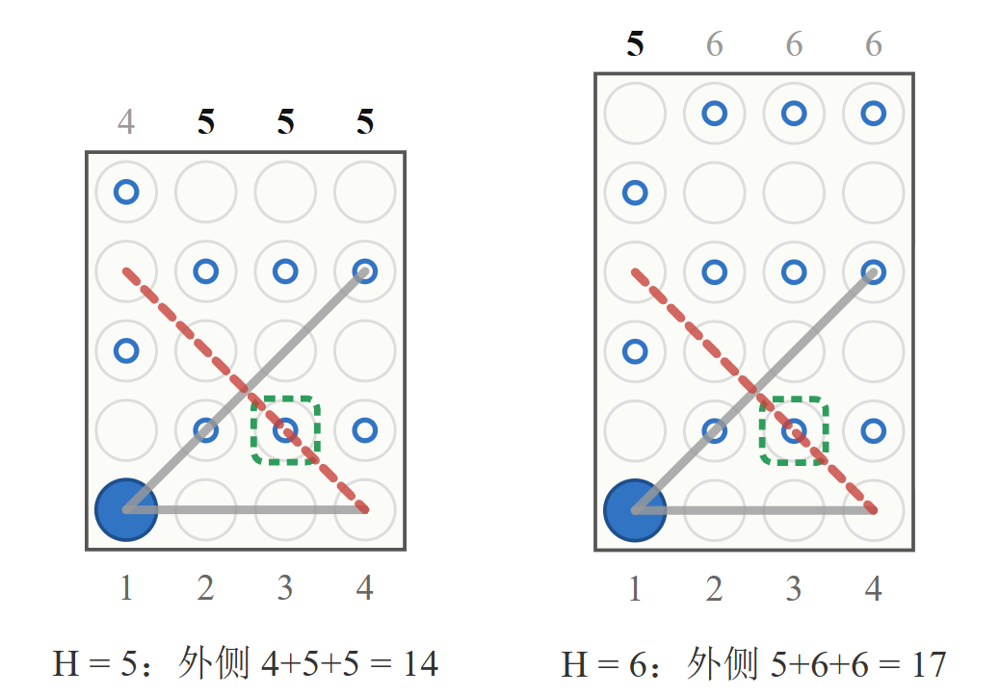
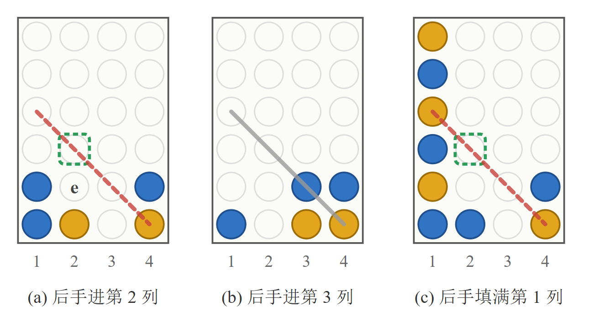
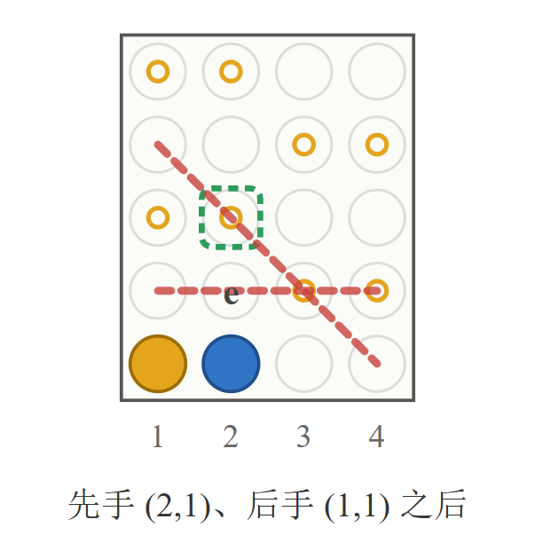
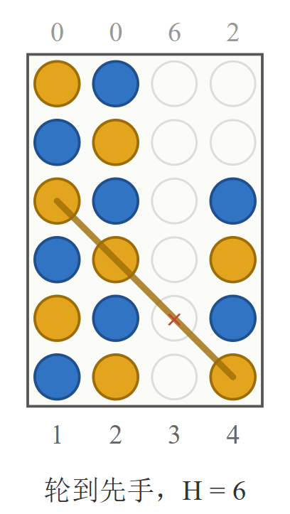

# 一至四列重力四子棋的和棋策略

## 能盖就盖、至多破例一次，以及 Lean 验证

GPT

2026 年 11 月 25 日

**摘要** 本文对宽度为一至四列的重力四子棋，在每个有限高度以及没有天花板的棋盘上，给出双方明确的不败策略，因此这些棋盘的博弈值都是和棋。两方的策略都从同一个动作出发，即在对手刚下的列中应一手，称为*盖*。能盖却改走另一列，称为*主动换列*。我们构造的策略整局至多主动换列一次。对四列棋盘，我们确定了不败策略在最坏情况下所需主动换列的确切次数：先手在偶数高度 *H* ≥ 4 时需要一次，其余高度不需要；后手在每个高度 *H* ≥ 2 时需要一次，*H* ≤ 1 时不需要。上界建立在三件事实上：

- 支撑下移：需要盯住的只剩底部的线和少数例外线。
- 保护格：一直盖下去，每列顶上往上数第偶数个格子都归守方。
- 剩余格数的奇偶：它决定守方能否不被逼进自己所依赖的保护格那一列。

下界由明确的反制策略给出。Lean 4 验证了这些棋盘的空盘和棋、最优主动次数，以及四列有限盘上先手至多四次、后手至多两次的总换列上界。

**关键词：**重力四子棋；不败策略；覆盖；奇偶；Lean 4；形式化验证。

## 1 引言

### 1.1 结果

棋盘有 1 ≤ *w* ≤ 4 列、高度为 *H*。先手 F 与后手 S 轮流投子，先连成四子者胜。*盖*指在对手刚下的那一列应手。应在别的列，若对手刚刚下满了自己那一列，称为*被动换列*，否则称为*主动换列*。先手的第一手不是应手，不计数。

**定理 1（覆盖策略）** 对 w ≤ 4 和每个有限高度 H ≥ 0，双方各有一个固定的不败策略：凡能盖时都盖，至多有一次例外，这次例外是一次主动换列。没有天花板的棋盘上结论同样成立。

**定理 2（四列棋盘的确切主动换列次数）** 不败策略在最坏情况下所需主动换列的最少次数如下：

| 高度         | 先手 | 后手 |
|--------------|------|------|
| *H* = 0, 1   | 0    | 0    |
| *H* = 2, 3   | 0    | 1    |
| 奇数 *H* ≥ 5 | 0    | 1    |
| 偶数 *H* ≥ 4 | 1    | 1    |
| 没有天花板   | 0    | 1    |

宽度不超过三列时，在每个有限高度和没有天花板时，双方都是 0 次。

**定理 3（换列总数）** 下文构造的四列有限高度策略，换列总数至多四次；其中后手的策略至多两次。这是对我们构造的上界，不是最优总数。

### 1.2 思路

守方若一直盖，对手在底行以上的每一枚棋子都压在守方的棋子上，例外只出现在守方没有盖的地方。这样被托住的四连不可能是对手的第一个四连，因为守方在下面一行的四连会更早完成。所以真正可能伤到守方的线只有两类：碰到底行的三条线，以及经过"对手棋子叠在自己棋子上"那几个格子的线。盖还决定了每一列的未来：对手进入某一列，守方立刻盖上，于是从当前列顶往上数第 2、4、6......格都归守方。只要给每条危险的线找一个这样的格子，并守住它，就够了。

有两件事会破坏这个计划。

*第一是底行。*先手的第一子已经挡住了底行。后手在底行还没有子，若它只会盖，先手四手就能连成底行。所以后手必须换一次列。

*第二是天花板。*对手下满一列时，守方只好下到别处，被下进的那一列，保护格整体错开一行。守方能否决定这种被迫的落子落在哪里，是个奇偶问题：一列只有剩下奇数个空格时，对手才能把它下满。

- 先手在奇数高度：所依赖的那一列之外，三列共有偶数个空格，先手从不会被逼进那一列，不需要主动换列。
- 先手在至少四行的偶数高度，这个数是奇数。第 7 节的反制说明，一次主动换列不可避免。

### 1.3 与已有工作的关系

- **Allis \[1, §2.2\]**：对至多六列、行数为正偶数的棋盘给出了后手的不败策略。Allis 称先手为白、后手为黑。本文一律用 F 和 S 表示先手和后手。我们直接证明四列的情形，并给出换列次数。Claimeven 与 \[1, §§6.1, 7.1\] 的偶数余量规则是相关背景。
- **Yamaguchi 等 \[2\]**：研究了若干落子规则下的无限棋盘。对没有天花板的棋盘，本文不主张优先权，只对本文的模型（有地板、没有天花板、至多四列）给出一个简短的自足证明。
- **Tromp \[3\]**：计算机搜索给出，四列、高度 4 至 11 的棋盘都是和棋。
- **本文的上一版 \[5\]**：本文取代 2026 年 9 月 13 日的版本。那一版对有限高度和棋的证明部分依赖有限证书；新的证明对所有高度统一成立，不依赖按局面枚举的大型证书，并增加了确切的主动换列次数及其下界。
- **配套论文 \[6\]**：讨论统一的回应算法及其压缩执行。

第 2、3 节确定规则并证明五个引理；第 4、5 节分别构造先手和后手的策略；第 6 节处理没有天花板的棋盘；第 7 节证明下界；第 8 节汇总定理；第 9 节说明形式化与计算检查。

## 2 规则与策略的代价

列从左到右编号 1 至 *w*，行从地板往上编号 1 至 *H*；(*c*, *r*) 表示第 *c* 列第 *r* 行。每一手把棋子放进某个未满列的最低空格。一方的四枚棋子横、竖或斜连成一线即获胜；出现第一个四连时对局立即停止，棋盘下满而无人四连则为和棋。没有天花板时有地板而没有顶行；永远不出现四连的对局算和棋。列的内容从下往上写，例如 \[FS, ∅, ∅, F\]。引理中 P 表示守方，Q 表示对手，不论谁先走。下面三条线反复出现：

*R*~0~ = (1,1)(2,2)(3,3)(4,4)，   *D* = (1,4)(2,3)(3,2)(4,1)，   *U*~1~ = (1,3)(2,4)(3,5)(4,6)。

策略在每个与它一致的历史上选定一手合法着法；构造允许多种选择时取最左一列。换列只统计一方。不败策略的*主动换列次数*，指它面对对手任何下法时主动换列的最多次数。定理 2 在所有不败策略（包括依赖整段历史的策略）中取这个数的最小值。本身获胜的应手照同样的规则计数。

## 3　五个引理

### 3.1 支撑下移与需要盯住的线

**引理 1（支撑下移）** 设一条非竖直的线不碰底行，线上四格都是 Q 的棋子，而且每一枚的正下方都是 P 的棋子。那么这四枚 Q 的棋子不是 Q 的第一个四连。

**证明** 四枚托底的 P 棋子恰好在下面一行的同一方向上。由重力，每一枚都早于压在它上面的那枚 Q 棋子落下，所以 P 在 Q 的最后一手之前已经完成了下面的四连。□

在轮到 Q 的局面中，*例外集* *E* 由两部分组成：底行以上每一枚叠在 Q 棋子上的 Q 棋子，以及每个未满且顶上是 Q 棋子的列的下一个空格。后一部分记下的是下次进入该列时可能出现的例外。*待查线*是碰到底行或经过 *E* 的非竖直线；不含 P 棋子的待查线称为*敞开的*。由引理 1，只要不出现新的例外，Q 在非竖直线上的第一个四连只能落在敞开的待查线上。

**引理 2（永久防守）** 在轮到 Q 的局面中，设每个未满列顶部连续的 Q 棋子至多两枚，并且没有敞开的待查线。那么 P 只要能盖就盖、在 Q 下满一列后任选一个合法列，就不会输。

**证明** 盖把 P 的棋子放在 Q 的棋子上，下满后的应手把 P 的棋子放在某个列顶上，两者都不产生新的例外；变成实际例外的潜在例外本来就在 *E* 中。列顶 Q 的连子增长一枚后即被盖住或碰到天花板，所以不会出现竖直四连。待查线上的 P 棋子一直都在，其他非竖直线由引理 1 排除。这个论证适用于 Q 的每一手、在 P 应手之前。除非 Q 刚下满那一列，盖总是合法的；下满时，只要棋盘未满就有别的合法着法。□

若轮到 P 时这些条件已经成立，P 的任何一手都保持它们，所以 P 可以随便下一手，再用引理 2。

### 3.2 保护格

**引理 3（保护格）** 在轮到 Q 时，设第 j 列已有 h 枚棋子。Q 走进第 j 列而仍可盖时，P 必须同列盖住。其余时候 P 都不进第 j 列。则每个仍在盘内的格子 (j, h + 2k)（k ≥ 1）此后始终为空或属于 P。

**证明。**只要此列未满，Q 每次进入均与 P 的盖子成对出现。在一对落子中，Q 占距起点为奇数的格，P 取下一个偶数格。如果 Q 下了最后一个空格，这也是奇数距离，之后该列再无合法落子。 □

这些格子称为*保护格*。只要引理 3 的前提成立，经过保护格的线 Q 就连不成。前提只会以一种方式失效：P 在别处被下满之后不得不下进第 *j* 列，或者自己选择下进去。下面两个引理正是控制这一点的。

### 3.3 一个预留格

**引理 4（一个预留格）** 在轮到 Q 的局面中，设未满列顶部连续的 Q 棋子至多两枚。设 t = (j, g) 是一个空格，g − h~j~ 为正偶数，其中 h~j~ 是第 j 列的高度；并设第 j 列以外的空格总数为偶数。再假设以下两者之一成立：

1.  （封线）每条敞开的待查线都经过 t；
2.  （制胜）P 已经占有一条经过 t 的线上的另外三格，并且每条敞开的待查线都经过第 j 列中不低于 t 的某个格子 (j, r)，r ≥ g。

P 能盖就盖；Q 下满第 j 列以外的某列后，P 下在第 j 列以外的另一列。那么 P 不会输，并且除非对局提前结束，P 一定会拿到 t。拿到 t 时：第 2 种情形 P 已经获胜；第 1 种情形可以接着用引理 2。

**证明** 先证规则合法。Q 走之前，第 *j* 列以外共有偶数个空格。若 Q 在其中下满了一列，它用掉的是至少两个空格中的一个，至少还剩一个留给 P。Q 下进第 *j* 列的棋子落在 *t* 下方奇数距离处，总能被盖住。所以每一轮要么用掉第 *j* 列以外的两格，要么用掉第 *j* 列的两格，奇偶恢复原状。于是 P 只为盖才进入第 *j* 列，由引理 3，*t* 是保护格，只有 P 能拿到它。设这一轮落子前的列高为 q。由于 g − q 是正偶数，Q 最多落到 g − 1，P 的同列应手仍在棋盘内。

再证 Q 的任何一手都不是第一个四连。经过 *t* 的线（第 2 种情形还有经过第 *j* 列中 *t* 以上格子的线）都还有一个空格；其他待查线上都有 P 的棋子。P 的落子不在 *E* 之外产生例外，所以其余非竖直线由引理 1 排除，竖直四连由列顶连子的长度排除。*t* 空着时棋盘不会满，而只有 P 能下 *t*，所以除非对局提前结束，P 最终会拿到它。第 2 种情形这一手即获胜；第 1 种情形此后每条敞开的待查线都有了 P 的棋子，正是引理 2 的前提。□

**预留格的奇偶。**四列棋盘共有 4*H* 个格子，是偶数。轮到 Q 时，剩余空格数在 P 先走时为奇数，在 P 后走时为偶数。因为 *g* − *h*~*j*~ 是偶数，第 *j* 列以外的空格数为偶数，恰好相当于：对先手，*H* − *g* 为奇数；对后手，*H* − *g* 为偶数。所以先手只有在奇数高度才能预留 (3,2)，偶数高度时，先手单独预留的格子必须在奇数行。第 4 节用到其中的第 3 行和第 5 行。第 4 节里奇数高度与偶数高度的差别，全都来自这一个恒等式。

**何时可以释放一列。**假如同时预留几个格子，每列至多留一个，目标距列顶都为正偶数，目标列以外的空格总数为偶数。每条敞开的待查线都须有目标保护，保护方式与引理 4 相同。若某个格子只负责封住经过它的线，要求取得它后该列还剩偶数格。拿到它就可以释放这一列。它负责的线已经有了固定的 P 子，列外的空格数增加 *H − g*，仍是偶数。另有两种目标可以直接结束等待。一个格子若能封住全部敞开的待查线，取得后就转入永久防守。若落在该格立即成四，对局当场结束。这两种目标都无须检查取得后的余量奇偶。等待期间，其他列被填满后的应手必须避开所有尚未兑现的目标列。每个完整回合消耗两个空格，等待一定会结束。下文的具体策略每次只需预留一个格子。

### 3.4 两列余量控制器

**引理 5（两列余量控制器）** 在轮到 Q 的局面中，设恰有两列（组成集合 R）剩下奇数个空格。P 一直盖，直到 Q 第一次下满某一列，这一列必属于 R；P 随即下在 R 的另一列，此后一直盖到终局。所有规定的着法都合法，唯一的换列是那次被动换列。

**证明** Q 的一手加上 P 的盖，从同一列取走两格，各列的奇偶不变。剩下偶数个（且大于零）空格的列 Q 下不满，因为 Q 落子后还剩奇数个、至少一个。Q 下满 *R* 中一列时，*R* 的另一列还剩奇数个、因而大于零的空格。P 下在那里之后，每一列都剩偶数个空格，此后 Q 的每一手都能被盖住。□

引理 5 只管合法性与换列次数，不管安全；安全在下文逐个情形证明。下面每种情形中，守住敞开线的格子都位于只接受盖的列中，因此由引理 3 受到保护。

## 4 先手

### 4.1 窄棋盘与低棋盘

宽度不超过三列时只有竖线。双方都能盖就盖，下满后任选一列。每到对手走时，每个非空未满列的顶上都是守方的棋子，所以对手连不成竖线。不需要主动换列；没有天花板时盖总是合法的。

四列棋盘：高度 0 一开始就满了；高度 1 时每方至多两枚棋子。高度 2 和 3 时只有横向四连。先手第一手任选一个底格，此后能盖就盖，下满后任选一列。第一手挡住第 1 行；后手在更高行的每一枚棋子都压在先手的棋子上，由引理 1 排除其余各行。先手不需要主动换列。

### 4.2 奇数高度 H ≥ 5：不必主动换列

先手第一手下 (1,1)。这一子挡住底行和 *R*~0~。后手还没有棋子，*E* 为空，唯一敞开的待查线是 *D*。预留 *t* = (3,2)：第 3 列是空的，距离为二；其余三列共有 (*H* − 1) + *H* + *H* = 3*H* − 1 个空格，是偶数（图 1）。引理 4 的封线情形成立。先手一直盖，下满后下在第 3 列以外；后手终于进入第 3 列时，先手盖上 (3,2)。所有换列都是被动的。

{width=70%}

**图 1** 先手第一手 (1,1) 之后、轮到后手的局面。灰色：已被挡住的底行与 *R*~0~。红色虚线：*D*，由预留格 (3,2)（绿框）守住。小圆圈：保护格。上方数字：各列剩余空格数。*H* = 5 时第 3 列以外共 14 个空格，正好两两用完；*H* = 6 时是 17 个，剩下一个落单。

### 4.3 偶数高度 H ≥ 4：在外侧两列等待

先手第一手下 (1,1)。若后手应在第 1 列，转第 4.4 节。否则先手只在第 1、4 列盖，中间两列不碰。每到后手走时，局面都是

W~*a*,*d*~ = \[F(SF)^*a*^, ∅, ∅, (SF)^*d*^\]，   *a*, *d* ≥ 0，   *a* ≥ 1 ⇒ *d* ≥ 1。

最后一个条件成立，是因为后手在第 1 列的落子要被盖住，前提是它的第一手已经下在第 4 列。第 4 列有偶数枚棋子，后手永远下不满；第 1 列有奇数枚，可能被下满。中间两列都空着时，任何非竖直线都要用到四列，所以连不成；外侧两列颜色交替，也连不成竖线。格子有限，必然发生以下三个事件之一（图 2）。

1.  **后手下 (2,1)。**先手下在第 1 列顶上，即第 2*a* + 2 ≤ *H* 行，这就是那一次主动换列。唯一的例外是潜在例外 (2,2)。它所在的横线，在 *a* = 0 时由 F(1,2) 挡住，在 *a* ≥ 1 时由 F(4,2) 挡住（因为此时 *d* ≥ 1）。它的上升斜线就是 *R*~0~，与底行一样由 (1,1) 挡住；它的下降斜线出了棋盘。若 *a* = 1，新下的子是 (1,4)，挡住了 *D*，用引理 2。否则按引理 4 的封线情形为 *D* 预留 (2,3)：距离为二，外侧空格数为偶数。
2.  **后手下 (3,1)。**先手盖 (3,2)，挡住 *D*。没有例外，用引理 2。
3.  **后手下满第 1 列。**先手下 (2,1)。第 1 列的顶子压在先手的棋子上，不构成例外；为 *D* 预留 (2,3)。

两种预留情形中，第 2 列都是唯一棋子数为奇数的列。所以 (2,3) 被拿到之前，后手下不满任何别的列，先手只需一直盖。事件这一手本身留着一个空的中间列，不可能获胜。只有事件 1 是主动换列。后手第一手若下在第 2 或第 3 列，就是 *a* = *d* = 0 时的事件 1 或 2。

{width=87%}

**图 2** *H* = 6 时外侧等待的三个事件，均为先手应手之后、轮到后手。(a)、(c) 中预留格 (2,3) 守住 *D*；(b) 中棋子 (3,2) 直接挡住 *D*。字母 e 标出潜在例外 (2,2)，它所在的横线由 F(1,2) 挡住。

### 4.4 偶数高度 H ≥ 4：全盘覆盖

F(1,1)、S(1,2) 之后，先手下 (4,1)，这是它唯一的一次主动换列；此后对后手的每一手都盖，直到后手下满某一列。每到后手走时，局面都是

V~*a*,*b*,*c*,*d*~ = \[FS(SF)^*a*^, (SF)^*b*^, (SF)^*c*^, F(SF)^*d*^\]。

前三列高度为偶数，所以只有第 4 列可能被下满。两个底角挡住了三条底线。唯一的例外（实际的或潜在的）是 (1,3)。它所在的横线由 (4,3) 守住，上升斜线 *U*~1~ 由 (2,4) 守住；到目前为止每一手都是盖，所以由引理 3，两格都是保护格。它的下降斜线出了棋盘。后手的连子至多两枚，即 (1,2)--(1,3)，随后被盖住。

后手终将下满第 4 列，这一列成为 F(SF)^*H*/2−1^S，(4,3) 永久是先手的棋子。先手被迫的那一手不能破坏剩下的保护。下表七种情形互不相交，且覆盖全部可能。

| 条件 | 应手与后续 |
|----|----|
| *H* = 4 | 任一合法着法；*U*~1~ 出了棋盘；用引理 2 |
| *H* ≥ 6，*a* = 0 | 下 (1,3)，消去潜在例外；用引理 2 |
| *H* ≥ 6，*a* ≥ 1，*b* ≥ 2 | 任一合法着法；(2,4) = F 挡住 *U*~1~；用引理 2 |
| *H* ≥ 6，*a* ≥ 1，*b* ≤ 1，*c* = 2 | 下 (3,5)，挡住 *U*~1~；用引理 2 |
| *H* ≥ 6，*a* ≥ 1，*b* ≤ 1，*c* ≤ 1 | 下 (3, 2*c*+1)；为 *U*~1~ 预留 (3,5)（引理 4，封线） |
| *H* ≥ 6，*a* ≥ 1，*b* = 1，*c* ≥ 3 | 下 (2,3)，在 *D* 上获胜 |
| *H* ≥ 6，*a* ≥ 1，*b* = 0，*c* ≥ 3 | 下 (2,1)；制胜格 (2,3)（引理 4，制胜） |

*a* ≥ 1 时例外 (1,3) 是实际的，它的横线已被 (4,3) = F 挡住，只剩 *U*~1~ 敞开。

- *c* ≤ 1：应手使第 3 列变成奇数高度，到 (3,5) 的距离变为 4 − 2*c*。
- *c* ≥ 3：*D* 上的 (1,4)、(3,2)、(4,1) 都是先手的棋子。*b* = 1 时先手立即连成 *D*；*b* = 0 时先手等待 (2,3)，它在 *U*~1~ 所需的 (2,4) 的下方。

两种预留情形中外侧空格数都是偶数：第 1、2 列或第 1、3 列高度为偶数，第 4 列已满。这些应手都发生在下满之后，属于被动换列。本节与第 4.3 节是互斥的两个分支，所以先手至多主动换列一次。

## 5 后手

### 5.1 偶数高度 H ≥ 2：Allis 配对

把列配成 {1,2} 与 {3,4} 两对。后手应在先手第一手所在列的搭档列底格，这是它的主动换列；此后按引理 5 走，*R* 取为初始那一对。

- **另一对。**换列之前，先手只占奇数行。所以它连不成斜线，因为斜线在相邻两列的格子行号奇偶相反；也连不成偶数行的横线。
- **初始那一对。**除第一子外，先手只占偶数行，这排除了第 3、5......行的横线；后手的底行棋子挡住第 1 行。
- **换列之后。**初始那一对中被下满的那一列，在第 3、5......行保留着后手的棋子，这些阻挡依然有效。
- **竖线。**先手唯一可能竖向相邻的一对棋子在第一子所在列的底部，随后被盖住或碰到天花板。

这个策略主动换列一次，被动换列至多一次。

### 5.2 奇数高度 H ≥ 3：先手第一手在中间列

由镜像 *c* ↦ 5 − *c*，只需讨论第一手在第 2 列和第 1 列。F(2,1) 之后，后手下 (1,1)，这是它的主动换列；此后按引理 5 走，*R* = {3,4}（图 3）。换列之前，每到先手走时局面都是 \[S(FS)^*a*^, F(FS)^*b*^, (FS)^*c*^, (FS)^*d*^\]。

- **底行与 *R*~0~：**由 S(1,1) 挡住。
- ***D*：**由 (2,3) 守住。第 2 列不在 *R* 中，只接受盖，所以 (2,3) 整盘都是保护格。
- **唯一的例外 (2,2)：**它所在的横线由 (3,2) 和 (4,2) 守住，两格在换列之前都是保护格。先手下满第 3 或第 4 列时，那一列的第 2 格已经永久是后手的棋子，所以即使换列使另一列错开一行，这条横线仍被挡住。经过 (2,2) 的上升斜线就是 *R*~0~。
- **竖线：**先手在第 2 列的棋子至多是 (2,1)--(2,2) 这一对，随后被盖住。

其余的线由引理 1 处理。这个论证适用于先手的每一手、在后手应手之前，包括下满一列的那一手。

{width=34%}

**图 3** *H* = 5 时后手对中间列开局的应对。金色小圆圈是保护格：(2,3) 守 *D*（同时是预留格，绿框），(3,2)、(4,2) 守经过潜在例外 e = (2,2) 的横线。第 3、4 列是引理 5 中的两个奇数列。

### 5.3 奇数高度 H ≥ 3：先手第一手在外侧列

F(1,1) 之后后手盖在 (1,2)。只要中间两列都空着，后手就只在外侧两列盖；局面是 \[(FS)^*a*^, ∅, ∅, (FS)^*d*^\]（*a* ≥ 1），谁也连不成四子。第一个事件决定应手：

| 先手的事件  | 后手的应手 | 之后的奇数列 |
|-------------|------------|--------------|
| 下 (2,1)    | (3,1)      | {1, 4}       |
| 下 (3,1)    | (2,1)      | {1, 4}       |
| 下满第 1 列 | (3,1)      | {2, 4}       |
| 下满第 4 列 | (2,1)      | {1, 3}       |

事件这一手留着一个空的中间列，不可能获胜；应手落在一个空的中间列，合法。此后按引理 5 走，*R* 取表中所列。

- **中间列事件之后：**两条中间列各有一枚棋子，底行有后手的棋子，(3,3) 守 *R*~0~，(2,3) 守 *D*。两格都在中间列，而中间列不在 *R* 中，所以由引理 3 受到保护。唯一的例外是底子为先手的那条中间列的第 2 格：它的横线含有 S(1,2)，它的斜线是 *R*~0~ 或 *D*。
- **第 1 列被下满之后（*H* ≥ 5）：**S(1,4) 挡住 *D*，(3,3) 守 *R*~0~；第 3 列不在 *R* 中。
- **第 4 列被下满之后：**S(4,4) 挡住 *R*~0~，(2,3) 守 *D*；第 2 列不在 *R* 中。
- ***H* = 3：**斜线不存在，底行已被挡住。

每种情形中主动换列至多一次，换列总数至多两次。

## 6 没有天花板的棋盘

没有天花板时没有哪一列会满，盖总是合法的，也没有被动换列。

- **先手：**第一手任选一列，此后永远盖。于是后手在先手第一手所在列只占偶数行，在其余三列只占奇数行。横向四连要用到全部四列，满足不了这两种奇偶。其余三列中有两列相邻，斜线在这两列需要奇偶相反的格子，也不可能。盖排除了竖线。所以先手不必换列。
- **后手：**应在搭档列底格，此后永远盖。第 5.1 节换列之前的论证永远适用，所以后手换列一次。

任何第一个四连都出现在某个有限时刻，而这些不变量在每个有限时刻都成立。这是直接的证明，不是有限高度策略的极限。

## 7 下界

### 7.1 后手

设 *H* ≥ 2，或者没有天花板。若后手从不主动换列，先手就依次下第 1、2、3、4 列的底格。前三手所在列都没满，后手被迫在第 2 行盖；第四手连成底行。所以后手的每个不败策略都至少主动换列一次。

### 7.2 偶数高度的先手

设 *H* = 2*m* ≥ 4。不主动换列的先手，只要后手那一列还没满就必须盖；下满之后它可以任意选择，并且可以依赖整段历史。由镜像，只需讨论第一手在第 1 列和第 2 列。

**第一手在外侧列。**F(1,1) 之后，后手在第 2 列下 *m* 次、第 4 列下 *m* − 1 次、第 1 列下 *m* − 1 次，每次都被盖住，然后下满第 1 列。整个过程中第 3 列是空的，所以没有非竖直四连；各列颜色交替，也没有竖直四连。轮到先手的局面是

\[F(SF)^*m*−1^S, (SF)^*m*^, ∅, (SF)^*m*−1^\]。

后手占有 *D* 上的 (1,4)、(2,3)、(4,1)，只差 (3,2)（图 4）。先手若进入第 3 列，S(3,2) 获胜。先手若下 (4, *H* − 1)，后手下满第 4 列，先手只能下 (3,1)，然后 S(3,2) 获胜。先手在此过程中连不成四子：第 3 列在其底格被下之前一直是空的，而这个底格不构成任何四连。

{width=26%}

**图 4** *H* = 6 时对付"从不主动换列"的先手的外侧陷阱。后手占有 *D* 的三格。第 3 列以外只剩两个空格，最后一个由后手拿走，先手被逼进 (3,1)。

**第一手在中间列。**F(2,1) 之后，后手在第 1 列恰好下两次（得到 SFSF），用 *m* 轮下满第 3 列，在第 4 列下一次，在第 2 列下 *m* − 1 次后下满它。轮到先手的局面是

\[SFSF, F(SF)^*m*−1^S, (SF)^*m*^, SF\]。

看准备完成时的棋盘。各列颜色交替，第 4 列只有两子，可能的两条横线都含两色。上升斜线无法在第 4 列的第 1 或第 2 行结束。下降斜线若止于 (4,1)，其两端 (1,4) 和 (4,1) 异色；若止于 (4,2)，其另一端 (1,5) 为空。先前的局面是这个棋盘的子集，所以准备期间没有人已成四。后手占有 *R*~0~ 上的 (1,1)、(2,2)、(3,3)。先手若进入第 4 列，就下在 (4,3)，S(4,4) 获胜。

*H* ≥ 6 时先手也可以进入第 1 列。此时后手在第 1 列一直应手，直到这一列满；先手仍不能主动换列，只好在这一列跟着下。第 4 行以上由 FS 对填满，所以 (1,6) 保持空着或是后手的棋子；最终先手被逼进第 4 列。在这段拖延中先手连不成四子：

- 竖直连子至多两枚。
- 第 2 行由 S(2,2) 挡住，第 3 行由 S(1,3) 挡住。
- 止于 (4,1) 的下降斜线含有 S(4,1)；止于 (4,2) 和 (4,3) 的下降斜线分别含有 S(2,4) 和 (1,6)。
- 止于第 4 列第 2、3 行的上升斜线会从地板以下开始；其余上升斜线需要更高处的空格。

准备阶段必须让第 1 列恰好停在高度四：提前下满它可能改变 (1,6)，从而给先手一条下降的四连。

因此在偶数高度 *H* ≥ 4，不主动换列的先手策略都不是不败的。下满之后的每一种自由选择，都被这两个陷阱覆盖。

## 8 换列计数与定理的汇总

每次被动换列都发生在对手下满一个此前未满的列之后，而所有列都满了就不再有应手，所以一方至多被动换列 *w* − 1 次。加上至多一次主动换列，四列棋盘上换列总数至多四次；第 5.1--5.3 节对后手给出两次。第 4--6 节给出具有所述主动换列次数的不败策略，第 7 节给出相应的下界，表中的 0 自然是最优的。这就证明了定理 1--3。

双方都按各自的策略下时，谁也不能先连成四子，所以有限棋盘以满盘无四连告终，没有天花板的棋盘永远不出现四连。由于每个策略都能对付对手的任何下法，在宽度至多四列的每个高度上，博弈值都是和棋。最优性只针对主动换列次数，不涉及换列总数或证明长度。

## 9　验证

Lean \[4\] 按实际对局的顺序检查和棋与换列次数。先手开局的第一枚棋子免费。若一手应棋恰好成四，这手仍计数。对手已经获胜或已填满棋盘时，应棋就此结束。策略在开局前固定，随后可读取整段对局历史。次数上界对沿着该策略走出的每一段合法历史都成立。

| 棋盘与结论 | 从哪个模块读起 |
|----|----|
| 四列、任意有限高度，双方的最优主动换列次数。 | `proof/Covering` 下的 `HistoryRoots` |
| 四列有限盘，先手至多换列四次，后手至多两次，含被动换列。 | `TotalSwitch` 和 `SecondTotal` |
| 一至三列、任意有限高度，双方都能以零次主动换列保证不败。 | `proof/Narrow` 下的 `NarrowCost` |
| 没有天花板时，一至三列双方都为零次。四列先手为零次，后手为一次，均为最优。 | `InfiniteCost` 和 `InfiniteExact` |

四列有限盘的主动次数上界由配套论文 \[6\] 的统一规则达到。先手只要达到这个主动次数上界，总换列就至多四次。对后手，`SecondTotal` 直接检查第 5 节的配对和等待策略，在同一套走法上同时得到主动次数与总次数上界。本文对总次数只证明上界。保护格的逐手不变量、多个目标逐个兑现和释放、两个奇余量列的换列规则，分别见 `ProtectedCells`、`Reserves`、`TwoOdd`。

两个工程都使用 Lean 4.34.0-rc2。四列有限盘仅使用 Lean 自带的库。另一个工程使用固定版本的 Mathlib，直接建模没有顶边的棋盘。一个无限高度策略要保证不败，必须在每个有限步数内都安全。两个工程各自在自己的棋盘模型中证明对应范围。两个工程分别从源码编译了 60 和 8 个模块，均通过信任级别为零的内核重放。分别核对 22 和 10 个选定声明的完整公理依赖，只出现 `propext`、`Classical.choice`、`Quot.sound`。源码哈希、验收记录和复现命令见[仓库核验指南](https://github.com/wugang6812/narrow-connect-four/blob/main/docs/verification.md)。

有限检查也可复现。坐标程序核对了先手的 396 个首列与高度组合，另核对后手的 199 个高度。参考规则在高度 0 至 12 上共重放 83,429 个状态和 238,014 条对手着法，另用 70 个边界局面对照 Lean 的实际回应。任意高度的结论来自以高度为参数的证明。

## 参考文献

\[1\] L. V. Allis. *A Knowledge-based Approach of Connect-Four. The Game is Solved: White Wins.* Master's thesis, Vrije Universiteit Amsterdam, Report IR-163, 1988；尤见 §§2.2, 6.1, 7.1。 [原文](https://tromp.github.io/c4/connect4_thesis.pdf#page=13)

\[2\] Y. Yamaguchi, K. Yamaguchi, T. Tanaka, T. Kaneko. Infinite Connect-Four is solved: draw. In *Advances in Computer Games*, LNCS 7168, 2012, pp. 208--219. doi:10.1007/978-3-642-31866-5_18. [原文](https://doi.org/10.1007/978-3-642-31866-5_18)

\[3\] J. Tromp. John's Connect Four Playground，已解棋盘尺寸表。https://tromp.github.io/c4/c4.html（2026 年 11 月 9 日访问）。 [原文](https://tromp.github.io/c4/c4.html)

\[4\] L. de Moura, S. Ullrich. The Lean 4 theorem prover and programming language. In *CADE 28*, LNCS 12699, 2021, pp. 625--635. doi:10.1007/978-3-030-79876-5_37. [原文](https://doi.org/10.1007/978-3-030-79876-5_37)

\[5\] Draw Strategies for Narrow Connect Four: All Finite Heights and Lean Verification。本文的上一版，2026 年 9 月 13 日（GitHub），已由本版取代。 [存档](https://github.com/wugang6812/narrow-connect-four/tree/v0.1.0)

\[6\] GPT. 四列重力四子棋的统一回应算法与交替段压缩。配套论文，2026 年 11 月 8 日。 [存档](https://github.com/wugang6812/narrow-connect-four/blob/main/papers/algorithm-zh.pdf)
